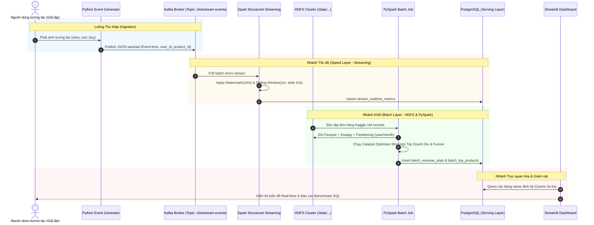

# KIẾN TRÚC HỆ THỐNG ĐƯỜNG ỐNG DỮ LIỆU TMĐT THỜI GIAN THỰC (NHÓM 3 - IT4931)

## 1. Sơ đồ Kiến trúc Tổng thể (System Architecture)

```mermaid
flowchart TB
    subgraph INGESTION["1. TẦNG THU THẬP DỮ LIỆU (Ingestion Layer)"]
        direction TB
        Gen["Python Event Generator<br>(Clickstream Simulator)"]
        Kaf["Apache Kafka Broker<br>(Topic: clickstream-events)"]
        ZK["Apache Zookeeper<br>(Cluster Coordination)"]
        ZK --- Kaf
        Gen -->|JSON Message (Kafka Producer)| Kaf
    end

    subgraph STORAGE["2. TẦNG LƯU TRỮ PHÂN TÁN (Distributed Storage Layer - HDFS)"]
        direction TB
        NN["HDFS NameNode<br>(Metadata & Namespace Manager)"]
        DN["HDFS DataNodes<br>(Block Size: 128MB, Rep: 1)"]
        NN --- DN
        RawHDFS["/data/raw/<br>- orders_1m.csv<br>- clickstream/*.json"]
        RefHDFS["/data/refined/<br>- orders.parquet (Snappy, year=/month=/)<br>- clickstream.parquet (event_type=/)"]
        DN --> RawHDFS
        DN --> RefHDFS
    end

    subgraph PROCESSING["3. TẦNG XỬ LÝ DỮ LIỆU PHÂN TÁN (Processing Layer - Apache Spark)"]
        direction TB
        SM["Spark Master (Standalone Coordinator)"]
        SW["Spark Workers (Executor Containers)"]
        SM --- SW

        subgraph BATCH["Batch Processing Layer (PySpark / Spark SQL)"]
            B_ETL["ETL & Conversion<br>(CSV -> Parquet + Snappy + Partitioning)"]
            B_Analytics["Deep Analytics<br>- Doanh thu theo thời gian / danh mục<br>- Top 10 sản phẩm bán chạy<br>- Phân tích hành vi đơn hàng"]
            B_Opt["Tối ưu hóa: Catalyst & CBO<br>Predicate Pushdown, Partition Pruning"]
            B_ETL --> B_Analytics
            B_Analytics --> B_Opt
        end

        subgraph STREAM["Speed Processing Layer (Spark Structured Streaming)"]
            S_Consumer["Kafka Source Consumer<br>(clickstream-events)"]
            S_Window["Event-Time Windowing<br>(Sliding Window 1 min, slide 10s)"]
            S_Watermark["Watermarking (10 mins)<br>(Late data handling & State cleanup)"]
            S_Agg["Real-time Aggregates<br>- Lượt tương tác theo phút<br>- Tỷ lệ click / add-to-cart / buy"]
            S_Consumer --> S_Window --> S_Watermark --> S_Agg
        end
    end

    subgraph SERVING["4. TẦNG PHỤC VỤ (Serving Layer)"]
        Postgres[("PostgreSQL Database<br>- batch_revenue_stats<br>- batch_top_products<br>- stream_realtime_metrics")]
    end

    subgraph VISUALIZATION["5. TẦNG TRỰC QUAN HÓA & BENCHMARK (Visualization & Evaluation)"]
        direction TB
        Dashboard["Streamlit Web Dashboard<br>- Tab 1: Real-time Kafka Monitor<br>- Tab 2: Batch Business Analytics<br>- Tab 3: Benchmark SQL Performance"]
        Bench["SQL Benchmark Suite<br>- CSV Raw vs Parquet vs Partitioned Parquet<br>- Execution Time, Bytes Read, CPU/RAM"]
        Dashboard --- Bench
    end

    %% Luồng liên kết
    Kaf -->|Kafka Consumer API| S_Consumer
    Kaf -.->|Định kỳ nạp thô| RawHDFS
    RawHDFS -->|Đọc file thô| B_ETL
    B_ETL -->|Ghi dữ liệu chuẩn hóa| RefHDFS
    RefHDFS -->|Đọc phân tích chuyên sâu| B_Analytics
    B_Opt -->|Ghi kết quả Batch Views (JDBC)| Postgres
    S_Agg -->|Ghi kết quả Speed Views (JDBC Upsert)| Postgres
    Postgres -->|Query phục vụ Dashboard| Dashboard
```

## 2. Luồng Xử lý Dữ liệu Chi tiết (Data Pipeline Flow)



